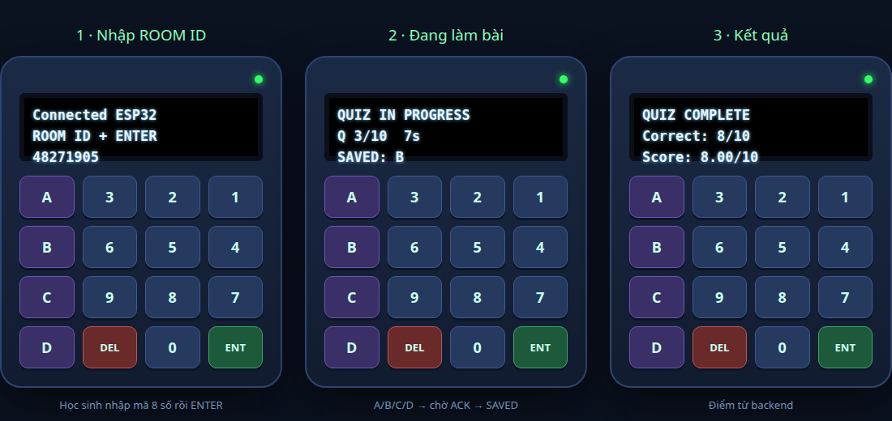

# Plan: "ESP32 ảo" trên trình duyệt, truy cập qua link Tailscale

Mục tiêu: học sinh không có thiết bị mở một đường link trên điện thoại/laptop và thấy **đúng giao diện thiết bị ESP32 thật** (màn OLED 128×32 + bàn phím 4×4), thao tác y như bấm phím vật lý, vào cùng phòng với các thiết bị thật.

Ngày lập: 2026-10-13. Căn cứ: `firmware/esp32-classroom/src/main.cpp`, `docs/STUDENT_WEB.md`, `client/src/pages/student.tsx`, `client/src/student-client.ts`, `server/student.ts`, `esp32-simulator/`.

---

## 1. Ý tưởng chính (tóm tắt)

**Không cần làm backend mới.** Repo đã có sẵn cổng học sinh `/student`:

| Đã có | Dùng lại như thế nào |
| --- | --- |
| `POST /api/student/join` (MSSV + Room ID, không cần tài khoản giáo viên, không cần `ENABLE_SIMULATOR`) | Giống hệt luồng ESP32 thật nhập ROOM ID → MSSV |
| Cookie học sinh HttpOnly + CSRF + ticket WebSocket | Giữ nguyên, an toàn hơn simulator dùng secret thiết bị |
| `useStudentQuiz()` trong `client/src/student-client.ts` (WebSocket, snapshot, ACK, retry, `seq`, `request_id`) | Dùng nguyên hook, chỉ đổi phần hiển thị |
| Backend ghép MSSV, tính vào giới hạn 50 thiết bị, ghi đáp án, báo cáo | Không đổi |

Việc cần làm chỉ là **một trang frontend mới `/device`** ("skin ESP32"): vẽ thân máy + OLED + keypad, và một máy trạng thái nhỏ phản chiếu logic màn hình của firmware. Link Tailscale Funnel hiện tại đã trỏ vào app nên `https://<ten-may>.<tailnet>.ts.net/device` dùng được ngay sau khi build.

```
Điện thoại/laptop HS ──HTTPS──> Tailscale Funnel ──> app :3000
        │                                              │
   /device (skin ESP32)                    /api/student/* + /ws (đã có)
   └─ useStudentQuiz() ────────────────────────────────┘
```

## 2. Vì sao chọn hướng này (so với các hướng khác)

| Hướng | Nhận xét |
| --- | --- |
| **A. Skin mới trên `/student` API (đề xuất)** | Cùng origin → cookie/CSRF/`PUBLIC_ORIGIN` không đổi; không lộ secret thiết bị; ít code nhất. |
| B. Mở `esp32-simulator` (cổng 3210) qua Funnel | Server của nó chỉ bind `127.0.0.1`, kiểm tra Host, lưu secret ở máy chạy → không phải thiết kế cho nhiều người dùng chung. Bỏ. |
| C. Bật `ENABLE_SIMULATOR=true` + `/simulator` | README ghi rõ không bật trên production; trang đó là bảng điều khiển test, không phải thiết bị. Bỏ. |
| D. Biên dịch firmware sang WebAssembly chạy thật | "Y chan" nhất nhưng tốn công lớn (Adafruit/Arduino shim, Wi-Fi/NVS mock), rủi ro cao. Chỉ cân nhắc sau này. |

Cách chốt: **A**. Cố gắng giữ hành vi giống firmware bằng cách chép lại bảng chuỗi hiển thị và bộ đếm thời gian từ `drawOledStatus()` (main.cpp:343–402).

## 3. Giao diện "y chan thiết bị thật"

## 3.0 Ảnh demo giao diện (đã duyệt)



Ảnh `demo-esp32-ao.png` là mockup đã được chốt làm mẫu cho trang `/device`: 3 trạng thái (nhập ROOM ID, đang làm bài, kết quả), OLED 3 dòng, keypad 4×4 theo `KEY_MAP`, phím A–D màu tím, `DEL` đỏ, `ENT` xanh lá, đèn nguồn xanh. Màu thân/vị trí phím là ước lượng, sẽ tinh chỉnh theo ảnh thiết bị thật nếu có.

### 3.1 Màn OLED
- SSD1306 **128×32**, chữ trắng trên nền đen, font mặc định Adafruit 6×8 (21 ký tự/dòng), 3 dòng tại y = 0, 11, 22. Không dấu tiếng Việt (giống firmware).
- Vẽ bằng `<canvas width=128 height=32>` phóng to nguyên số nguyên (×4/×5) với `image-rendering: pixelated`, dùng font bitmap 5×7 nhúng sẵn (chép bảng glyph Adafruit GFX `glcdfont`) để đúng từng điểm ảnh. Phương án rẻ hơn nếu chưa kịp: font monospace pixel (VT323/"Press Start 2P") trong CSS, 21 cột × 3 hàng.
- `setTextWrap(false)`: cắt ở 21 ký tự như thật, không xuống dòng (trừ màn "Connected <SSID>" 3 giây – ở bản web bỏ SSID, hiện `Connected` + tên máy).

### 3.2 Bàn phím 4×4 (đúng `KEY_MAP`)
Bố cục theo thứ tự quét trong firmware, hiển thị theo hàng:

```
[ A ] [ 3 ] [ 2 ] [ 1 ]      S1  S5  S9  S13
[ B ] [ 6 ] [ 5 ] [ 4 ]      S2  S6  S10 S14
[ C ] [ 9 ] [ 8 ] [ 7 ]      S3  S7  S11 S15
[ D ] [DEL] [ 0 ] [ENT]      S4  S8  S12 S16
```

(Hàng/cột đúng theo `KEY_MAP` trong main.cpp:29–34; cần đối chiếu thêm với **ảnh thiết bị thật** để nhãn và màu phím giống nhau — xem mục 7.)

- Phím vật lý trên laptop: `A–D`, `0–9`, `Enter` = ENTER, `Backspace` = DELETE (cùng cách simulator độc lập đang làm).
- Cảm ứng điện thoại: nút lớn ≥ 56 px, `touch-action: manipulation`, `navigator.vibrate(10)` khi bấm, chặn zoom đúp, khóa xoay dọc.
- Thân máy: viền, 2 chân ESP32-C3 DevKitM-1, đèn nguồn nhấp nháy khi kết nối (CSS thuần). Bố cục lấy theo ảnh thiết bị.

## 4. Hành vi: máy trạng thái phản chiếu firmware

Chép logic từ `main.cpp` (không chép mạng — phần mạng dùng `useStudentQuiz`):

| Trạng thái | Dòng 1 | Dòng 2 | Dòng 3 | Phím |
| --- | --- | --- | --- | --- |
| Nhập phòng | `ROOM ID + ENTER` | — | số đang nhập (≤10) | 0–9, DEL, ENTER |
| Nhập MSSV | `STUDENT ID + ENTER` | — | số đang nhập | 0–9, DEL (rỗng → về ROOM ID), ENTER |
| Đang vào | `JOINED / WAITING` hoặc thông báo | `RETRY ENTER IN 60s` khi chưa rõ kết quả | | ENTER gửi lại *nguyên* yêu cầu |
| LOBBY | `READY / WAITING` | `N Q / S sec each` | | A–D = `button.test` (không chấm) |
| RUNNING | `QUIZ IN PROGRESS` | `Q i/N  Ts` | `SENDING: A` / `SAVED: A` | A–D = đáp án |
| PAUSED | `PAUSED` | `Q i/N  Ts` (đứng) | | A–D chặn |
| Hết giờ câu | `QUESTION CLOSED` | | | — |
| FINISHED | `QUIZ COMPLETE` | `Correct: x/y` | `Score: s/10` | ENTER mở lại nhập ROOM ID |
| Mất mạng | `CONNECTING WI-FI...` / `Connected` | | | chặn đáp án mới |

Các hành vi đặc thù phải giữ (đã nêu trong `firmware/esp32-classroom/README.md`):
1. **Tiết kiệm pin/OLED ngủ:** tắt sau 60 s (màn nhập), 20 s (chờ), 30 s (kết quả); luôn sáng khi RUNNING/PAUSED. **Phím đầu tiên khi màn ngủ chỉ đánh thức**, không nhập/gửi.
2. Thông báo tạm: 3 s (kết nối), 5 s (nhập liệu/lỗi).
3. `SENDING` → `SAVED` chỉ sau ACK của server; mất ACK gửi lại nguyên gói (đã có trong `useStudentQuiz`).
4. Đồng hồ đếm ngược theo giờ server (`quiz.offset`), không theo giờ máy học sinh.
5. Lỗi join dịch sang đúng câu trên OLED: `ROOM INVALID/EXPIRED`, `STUDENT NOT IN ROOM`, `STUDENT IN USE`, `NOT ON THE LIST / PLEASE RE-ENTER`.

Lưu ý khác biệt có chủ ý so với firmware: ESP32 thật đang nhập MSSV **sau** ROOM ID rồi mới join một lần; `/api/student/join` nhận cả hai trong một request nên màn hình vẫn đi qua 2 bước nhập, đến ENTER ở bước MSSV mới gọi API.

## 5. Phạm vi chức năng

| Chức năng | Thiết bị thật | `/device` v1 | Ghi chú |
| --- | --- | --- | --- |
| Vào phòng ROOM ID + MSSV | ✓ | ✓ | `/api/student/join` |
| Làm bài A/B/C/D, ACK, retry | ✓ | ✓ | `useStudentQuiz` |
| Xem điểm cuối buổi | ✓ | ✓ | |
| Khôi phục khi tải lại trang | (NVS) | ✓ | cookie + `pending` từ `/api/student/session` |
| Flashcard (A = Nhớ, B = Chưa nhớ) | ✓ | ✗ | **Student Web chưa hỗ trợ** poll/flashcard/attendance |
| Khảo sát nhanh, điểm danh | ✓ | ✗ | như trên |

→ v1 chỉ quiz. Muốn đủ flashcard/khảo sát/điểm danh thì cần thêm packet vào `server/student.ts` và `useStudentQuiz` (giai đoạn 3, mục 8) — đây là phần duy nhất đụng backend.

## 6. Tailscale — cách đưa link ra cho học sinh

1. Dùng **chính Funnel đang chạy** (xem `docs/TAILSCALE_MAY_KHAC.md`): `tailscale funnel --bg 3000`. Link cuối: `https://<ten-may>.<tailnet>.ts.net/device`.
2. **Giữ cùng một origin** với trang giáo viên. Đừng tách hostname/cổng khác: cookie, CSRF, `PUBLIC_ORIGIN` và kiểm tra `Origin` sẽ lỗi (`BAD_ORIGIN`). `/device` chỉ là thêm một route.
3. Env tối thiểu (production): `NODE_ENV=production`, `TRUST_PROXY=1`, `PUBLIC_ORIGIN=https://<ten-may>.<tailnet>.ts.net`, `ENABLE_SIMULATOR=false`.
4. Phòng giáo viên hiện có "đường dẫn trang làm bài" (`/student`); thêm nút/QR thứ hai "Mở thiết bị ảo" trỏ `/device`.
5. Học sinh **không cần cài Tailscale hay đăng nhập** — Funnel là public. Nếu muốn chỉ người trong tailnet vào được thì dùng `tailscale serve` thay `funnel` (người dùng phải cài app Tailscale).

## 7. Kế hoạch triển khai theo giai đoạn

### Giai đoạn 1 — Skin chạy được (≈ 1 ngày)
- [ ] Route `/device` trong `client/src/main.tsx` (lazy, giống `StudentPage`, cũng miễn đăng nhập giáo viên).
- [ ] `client/src/pages/device.tsx`: thân máy + canvas OLED + keypad; `device.css`.
- [ ] Máy trạng thái nhập ROOM ID/MSSV; gọi `studentApi("/join")` như `student.tsx` (giữ `request_id`, xử lý `uncertain`, danh sách mã lỗi không retry).
- [ ] Hiển thị LOBBY/RUNNING/PAUSED/FINISHED từ `useStudentQuiz()`.
- [ ] Bàn phím vật lý + cảm ứng.

### Giai đoạn 2 — Giống thật hơn (≈ 0,5–1 ngày)
- [ ] Bảng glyph pixel đúng Adafruit 5×7; hiệu ứng ngủ/đánh thức OLED theo 20/30/60 s.
- [ ] Thông báo 3 s / 5 s, đếm ngược 60 s khi chờ retry join.
- [ ] Đối chiếu ảnh thiết bị thật: màu thân, vị trí chân, nhãn S1–S16.
- [ ] Giao diện điện thoại: full-screen, `viewport-fit=cover`, Wake Lock API để màn hình không tắt khi đang thi, manifest PWA (thêm vào màn hình chính).

### Giai đoạn 3 — Đủ chức năng thiết bị (tùy chọn, chạm backend)
- [ ] Thêm flashcard / poll / attendance vào `server/student.ts` + `useStudentQuiz` (tái dùng schema packet đã có trong `shared/protocol.ts`).
- [ ] Phím tương ứng: A/OK = Nhớ, B/DEL = Chưa nhớ; điểm danh = phím bất kỳ.

### Giai đoạn 4 — Kiểm thử
- [ ] Unit test máy trạng thái (giống `scripts/test-oled-display.mjs`: dùng `assert`, không framework): chuỗi hiển thị theo từng trạng thái, ngủ/đánh thức, phím đầu tiên chỉ đánh thức.
- [ ] Chạy `npm run test:student-web` (đã có) — không được hỏng.
- [ ] Thử tay: 1 laptop + 1 điện thoại cùng vào một phòng cùng ESP32 thật/simulator; mất mạng giữa chừng; tải lại trang; hết giờ; tạm dừng.
- [ ] Thử tải: 50 thiết bị (thật + ảo) trong một phòng — giới hạn chung của phòng.

## 8. Rủi ro / điểm cần quyết định

| Vấn đề | Đánh giá | Hướng xử lý |
| --- | --- | --- |
| Ai cũng biết link, có thể đoán MSSV + Room ID | MSSV/Room ID tự khai giống ESP32; Room ID chỉ sống 5 phút và chỉ khi giáo viên mở nhận | Đã có `limitJoin`; giáo viên kiểm tra danh sách "Học sinh đã kết nối"; có thể thêm mã PIN ngắn nếu cần |
| Cùng MSSV vào bằng web và ESP32 | Backend từ chối `STUDENT_BUSY`/`STUDENT_ALREADY_BOUND` | Hiển thị `STUDENT IN USE`; giáo viên gỡ thiết bị cũ |
| Gian lận (nhiều người dùng chung máy/tab) | Mỗi MSSV một kết nối hiệu lực, tab mới thay tab cũ | Giữ nguyên |
| Máy chủ nhà qua Funnel chịu tải nhiều học sinh | Tailscale Funnel có giới hạn băng thông; lớp 30–50 HS ổn với WebSocket nhỏ | Thử tải trước buổi thật; có phương án LAN |
| "Y chan" phụ thuộc ảnh/kích thước phần cứng | Cần ảnh/ bản vẽ thiết bị | **Cần bạn cung cấp ảnh thiết bị thật (mặt trước)** để khớp bố cục/màu |
| Firmware thay đổi (chuỗi OLED, timeout) | Skin phải đồng bộ | Gom hằng số chuỗi/timeout vào một file `device-ui-spec.ts`, ghi chú trỏ về `main.cpp` |

## 9. Câu hỏi cần bạn chốt trước khi làm

1. Có ảnh thiết bị thật (mặt trước, thấy rõ nhãn phím và màn OLED) không?
2. v1 chỉ quiz có đủ không, hay cần flashcard/khảo sát/điểm danh ngay (giai đoạn 3)?
3. Đường link: `/device` trên **cùng** link Funnel hiện tại (khuyến nghị) hay muốn tên/hostname riêng?
4. Có muốn thêm bước chặn lạm dụng (PIN lớp / giới hạn số web-device) không?

## 10. Kết quả mong đợi

- Học sinh mở `https://<ten-may>.<tailnet>.ts.net/device`, nhập ROOM ID → MSSV bằng bàn phím ảo, thấy màn OLED hiện đúng dòng chữ như thiết bị thật, bấm A/B/C/D trả lời, xem điểm ở cuối buổi.
- Giáo viên thấy học sinh này trong **Học sinh đã kết nối** như một thiết bị bình thường; báo cáo/Excel gồm cả đáp án từ ESP32 thật và thiết bị ảo.

---

# Phần B — Nâng cấp "Củng cố kiến thức bằng AI" (thay OpenRouter bằng Gemini)

Ngày bổ sung: 2026-10-13.

## B1. Hiện trạng (đã đọc code)

- UI: thẻ `StudyPlan` trong trang Báo cáo (`client/src/pages/study-plan.tsx`).
- Phần không cần AI (ổn định): chủ đề yếu cả lớp, câu nên giảng lại, câu sai từng học sinh, tạo flashcard ôn tập (`POST /api/sessions/:id/review-deck`) + link tự học `/study/<token>`.
- Phần AI (không ổn định): `POST /api/sessions/:id/study-guide` → `server/study-guide.ts` → OpenRouter `openrouter/free`. Trả `explanations` (lời giải từng câu sai) + `practice` (3 câu luyện thêm). Kết quả **không lưu DB**.
- Nguyên nhân bất ổn: free router chọn model ngẫu nhiên, quota 50 request/ngày, validate chặt (`EXPLANATION_MISMATCH`, `MIXED_LANGUAGE`, `INVALID_SHAPE`) khiến phải thử lại và tốn thêm quota.

## B2. Hướng thay thế: Gemini API (Google AI Studio)

Gói Google AI Pro/Gemini Advanced là thuê bao cho app Gemini, **không** cấp quota API. API dùng key riêng từ AI Studio, có free tier với tài khoản Google bất kỳ.

| Hạng mục | Quyết định |
| --- | --- |
| Nhà cung cấp chính | Gemini API, model dòng **Flash** (nhanh, rẻ, tiếng Việt khá) |
| Ép đầu ra | `responseMimeType: "application/json"` + `responseSchema` theo `guideSchema` → giảm `INVALID_JSON/INVALID_SHAPE` |
| Giao diện giữ nguyên | `createStudyGuide(input, keys, models)` và kiểu `StudyGuide` không đổi → UI/route không sửa |
| Dữ liệu gửi đi | Giữ nguyên: chỉ đề, 4 lựa chọn, đáp án chọn/đúng, chủ đề, ghi chú giáo viên; **không gửi tên/MSSV** |
| Khóa | `GEMINI_API_KEY` trong `.env` phía server, không đưa vào `VITE_*` hay frontend |
| Nhà cung cấp dự phòng | Giữ OpenRouter làm phương án 2 (tùy chọn), hoặc một mô hình trả phí nếu cần ổn định tuyệt đối |

Lưu ý: free tier có thể dùng dữ liệu gửi lên để cải thiện sản phẩm; bản trả phí thì không. Hạn mức từng model do Google quy định và có thể đổi — kiểm tra trên AI Studio trước khi dùng thật.

## B3. Cách lấy API key (bạn tự làm — cần đăng nhập tài khoản Google của bạn)

1. Mở https://aistudio.google.com/apikey (đã đăng nhập tài khoản Pro).
2. Bấm **Create API key** → chọn/ tạo một Google Cloud project → sao chép key (dạng `AIza...`).
3. Trên máy chủ, mở `.env` ở thư mục gốc và thêm dòng:

   ```dotenv
   GEMINI_API_KEY=AIza...dan-key-vao-day
   ```

   Không đặt ngoặc kép, không commit `.env`, không dán key vào chat. (`.env` đã nằm trong `.gitignore`.)
4. Khởi động lại app (`npm start`) để nạp cấu hình.

## B4. Các thay đổi code (kế hoạch)

| # | Việc | File |
| --- | --- | --- |
| 1 | Đọc `GEMINI_API_KEY`, `GEMINI_MODEL` (mặc định một model Flash) | `server/config` / nơi đọc `OPENROUTER_API_KEYS`, `.env.example`, `docs/RUNBOOK.md` |
| 2 | Tách hàm gọi nhà cung cấp: `callGemini()` + giữ `callOpenRouter()`, chọn theo biến môi trường | `server/study-guide.ts` |
| 3 | Dùng `responseSchema` ép JSON; bỏ phần regex bắt lỗi nặng chỉ giữ kiểm tra khớp đáp án | `server/study-guide.ts` |
| 4 | `user.ai` bật khi có bất kỳ key hợp lệ (Gemini hoặc OpenRouter) | `server/app.ts` |
| 5 | Thông báo lỗi 429/quota rõ ràng, không đổi key để né giới hạn | `server/study-guide.ts` |

## B5. Làm cho ổn định hơn (giai đoạn sau)

1. **Lời giải theo câu hỏi, không theo học sinh:** tạo một lời giải + phân tích từng đáp án nhiễu cho mỗi câu, lưu DB (bảng mới + migration 009), dùng lại cho mọi học sinh. Giảm số lần gọi AI hàng chục lần; giáo viên duyệt/sửa được.
2. **Lưu kết quả AI** theo (buổi, học sinh) để tải lại không mất và không tốn quota.
3. **Câu luyện thêm thành bộ đề/flashcard thật** để có kết quả quay lại; mở được trên `/study/<token>` hoặc `/device`.
4. **Lớp dự phòng không AI:** khi AI lỗi vẫn hiện ghi chú giáo viên, đáp án nhiễu phổ biến, flashcard ôn tập (đã có sẵn trong UI).
5. **Ollama cục bộ (tùy chọn)** làm phương án cuối khi mất mạng.

## B6. Kiểm thử

- Test đơn vị `callGemini` bằng `fetch` giả: JSON hợp lệ, JSON sai shape, 429, 5xx, timeout.
- Kiểm tra dữ liệu gửi đi không chứa tên/MSSV.
- Thử thật 1 buổi đã kết thúc: bấm "AI giải chi tiết" cho 3 học sinh, đo thời gian và tỷ lệ lỗi.
- Chạy `npm run typecheck` và `npm run test:auth` không hỏng.

## B7. Quyết định đã chốt (2026-10-13)

| Mục | Quyết định |
| --- | --- |
| Nhà cung cấp chính | **Gemini API** (key tạo từ Google AI Studio) |
| Dự phòng | **Giữ OpenRouter** (`OPENROUTER_API_KEYS`): chỉ gọi khi Gemini lỗi hoặc không có key |
| Cấu hình | `GEMINI_API_KEY` đã được thêm vào `.env` (quyền 600, `.env` nằm trong `.gitignore`); chưa commit |
| Trạng thái code | **Chưa sửa code** — backend hiện chưa đọc `GEMINI_API_KEY`; cần làm B4 để key có hiệu lực |

### Thứ tự gọi nhà cung cấp

1. Có `GEMINI_API_KEY` → gọi Gemini (ép JSON theo schema).
2. Gemini lỗi mạng/5xx/timeout hoặc JSON sai shape sau 1 lần thử lại → chuyển sang OpenRouter nếu có `OPENROUTER_API_KEYS`.
3. Lỗi 429 (hết quota): **không** đổi nhà cung cấp để né giới hạn; báo rõ cho giáo viên và gợi ý chờ.
4. Cả hai lỗi → trả lỗi gọn, UI vẫn hiện phần ôn tập không cần AI (flashcard, chủ đề yếu, ghi chú giáo viên).

## B8. Bảo mật khóa

- Key đã từng được dán vào cuộc trò chuyện này → **nên xem là đã lộ**. Sau khi chạy ổn, vào AI Studio **tạo key mới, xóa key cũ**, rồi cập nhật `.env`.
- Nên đặt giới hạn (API restriction) và cảnh báo chi phí cho key/project trong Google Cloud Console.
- Không ghi key vào log, báo cáo, `README`, `PLAN_*.md`, `VITE_*` hay Git. `providerErrorMessage` hiện đã ẩn key trong lỗi OpenRouter; cần làm tương tự cho Gemini (key nằm trong URL/header).
- Dữ liệu gửi lên vẫn chỉ gồm nội dung câu hỏi/lựa chọn, không có tên hay MSSV.

## B9. Việc tiếp theo

1. Làm B4: thêm `callGemini()`, đọc `GEMINI_API_KEY`/`GEMINI_MODEL`, chuỗi dự phòng như trên, cập nhật `.env.example` và `docs/RUNBOOK.md`.
2. Thử thật trên một buổi đã kết thúc (B6).
3. Sau đó mới làm B5 (lưu lời giải theo câu hỏi trong DB).

---

# Phần C — Đa ngôn ngữ Tiếng Việt / English trên web

Ngày bổ sung: 2026-10-13. Chưa sửa code.

## C1. Khảo sát hiện trạng (đã đếm trong `client/src`)

| Mục | Số liệu |
| --- | --- |
| File giao diện chứa chuỗi tiếng Việt | 21 file (lớn nhất: `manage.tsx` ~143 dòng, `session.tsx` ~136, `flashcards.tsx` ~110, `reports.tsx` ~95) |
| Chuỗi tiếng Việt khác nhau | ≈ 900 |
| Chuỗi nằm ngoài JSX | `api.ts` (`stateLabel`, `eventLabel`, `errorLabel`, lỗi mạng), `socket.ts`, `student-client.ts`, `quiz-config.tsx` |
| Định dạng số/ngày cứng `vi-VN` | 22 chỗ (`toLocaleString`, `fmt`) |
| `<html lang="vi">` | `client/index.html`, cứng |
| Chuỗi từ server | `AppError(code, message tiếng Việt)` → hiện nguyên văn ở `api()` |
| Nơi lưu lựa chọn giao diện sẵn có | `theme.tsx`: `localStorage` + `ThemeToggle` (mẫu để làm `LangToggle`) |
| Ngoài giao diện web | Báo cáo Excel/PDF, prompt AI (ra tiếng Việt), OLED firmware (đã là tiếng Anh không dấu) |

## C2. Hướng thiết kế (nhẹ, không thêm thư viện)

**Không dùng i18next/react-intl.** Dự án có ~900 chuỗi và một ngôn ngữ phụ; một module nhỏ tự viết là đủ.

- `client/src/i18n.tsx`: `LangProvider`, hook `useLang()`, hàm `t(vi, params?)`, `ThemeToggle`-style `LangToggle` (nút `VI | EN`).
- **Khóa = chính câu tiếng Việt gốc.** `t("Tạo lớp")` trả về `"Tạo lớp"` nếu ngôn ngữ là `vi`, hoặc `en["Tạo lớp"]` = `"Create class"` nếu `en`. Thiếu bản dịch → tự rơi về tiếng Việt, không bao giờ hiện trống.
  - Ưu: sửa code ít nhất (bọc chuỗi), đọc code vẫn hiểu, không cần đặt tên khóa.
  - Nhược: đổi câu tiếng Việt thì phải đổi khóa trong từ điển → có script kiểm tra (C6).
- Từ điển: `client/src/locales/en.ts` (`Record<string,string>`); tiếng Việt là ngôn ngữ gốc nên không có `vi.ts`.
- Có tham số: `t("Còn {n} giây", { n: 7 })`; số nhiều đơn giản bằng hai chuỗi (`"{n} câu"`/`"{n} question(s)"`), không cần ICU.
- **Lưu lựa chọn:** `localStorage["classroom-lang"]`, mặc định theo `navigator.language` (`vi*` → vi, còn lại → en). Bọc try/catch như `theme.tsx`. Đồng bộ giữa các tab bằng sự kiện `storage`.
- Khi đổi ngôn ngữ cập nhật `document.documentElement.lang`, tiêu đề tab (`document.title`) và `meta description` nếu có.
- **Định dạng số/ngày:** một hàm `fmtLocale()` dùng `vi-VN` hoặc `en-US` theo ngôn ngữ; thay 22 chỗ cứng `vi-VN`.

```
LangProvider (main.tsx)
 ├─ t("Tạo lớp")  ── vi → "Tạo lớp"  /  en → en["Tạo lớp"] ?? "Tạo lớp"
 ├─ <LangToggle/> cạnh <ThemeToggle/> (trang giáo viên, /student, /device, /study/*, /present/*)
 └─ localStorage "classroom-lang" + <html lang>
```

## C3. Chuỗi do server trả về

| Loại | Cách xử lý |
| --- | --- |
| Lỗi có `code` ổn định (`ROOM_UNAVAILABLE`, `STUDENT_BUSY`, …) | Client dịch theo `code` qua bảng `errorLabel` (đã có sẵn một phần trong `api.ts`), rơi về `message` của server |
| Lỗi chỉ có `message` tiếng Việt | Tra `en[message]`; thông báo có số/tên (ví dụ "Lời giải câu 3 không khớp") dùng mẫu `"Lời giải câu {n} không khớp đáp án. Thử lại."` |
| Dữ liệu người dùng (tên lớp, đề, câu hỏi) | **Không dịch**, giữ nguyên |
| Nhãn trạng thái (`stateLabel`, `eventLabel`) | Chuyển thành hàm/ bảng song ngữ, gọi qua `t()` |
| Tùy chọn lâu dài | Server đọc header `X-Lang`/`Accept-Language` và trả `message` đúng ngôn ngữ; **chưa làm ở giai đoạn đầu** |

## C4. Phạm vi và thứ tự ưu tiên

| Giai đoạn | Nội dung | Lý do |
| --- | --- | --- |
| **C-1 Hạ tầng** | `i18n.tsx`, `LangToggle`, `locales/en.ts`, `lang` trên `<html>`, `fmtLocale`; thử trên `components.tsx`, `theme.tsx`, `main.tsx` (menu, đăng nhập) | Chạy được xuyên suốt trước khi dịch hàng loạt |
| **C-2 Trang học sinh/công khai** | `student.tsx`, `student-client.ts`, `socket.ts`, `study`/flashcard tự học (`/study/*`), `/device` (khi làm xong) | Người dùng ngoài lớp/quốc tế thấy đầu tiên; ít chuỗi |
| **C-3 Trang giáo viên** | `session.tsx`, `reports.tsx`, `results-grid.tsx`, `score-stats.tsx`, `study-plan.tsx`, `polls.tsx`, `attendance.tsx`, `room-pairing.tsx` | Luồng chính khi dạy |
| **C-4 Quản lý** | `manage.tsx`, `banks.tsx`, `flashcards.tsx`, `quiz-config.tsx`, `simulator.tsx` | Nhiều chuỗi nhất, ít cần gấp |
| **C-5 Ngoài UI (tùy chọn)** | Tên cột/tiêu đề báo cáo Excel/PDF; ngôn ngữ đầu ra của AI (`study-guide.ts`: thêm tham số `lang`, prompt "viết bằng tiếng Anh") | Không bắt buộc cho "giao diện web" |

Mỗi giai đoạn dịch xong là dùng được ngay nhờ cơ chế rơi về tiếng Việt: chưa dịch tới đâu thì vẫn hiện tiếng Việt, không vỡ giao diện.

## C5. Việc kỹ thuật chi tiết

1. Tạo `client/src/i18n.tsx` (≈ 60 dòng): context, `t`, `useLang`, `LangToggle`, đọc/ghi `localStorage`, đồng bộ `storage`.
2. Bọc `<LangProvider>` ở gốc `main.tsx`; đặt `LangToggle` cạnh mọi `ThemeToggle` (5 chỗ) và trong header trang giáo viên.
3. Chuyển các hằng cấp module (`stateLabel`, `eventLabel`, `ratingLabel`, mảng nhãn trong component) thành hàm chạy trong component hoặc bảng khóa-tiếng-Việt rồi `t(...)` khi render — hằng cấp module **không** đổi theo ngôn ngữ nếu gọi `t` ở thời điểm import.
4. `api()` trong `api.ts` không phải component → dùng `getLang()` (đọc từ biến module do `LangProvider` cập nhật) để dịch lỗi mạng và `message`.
5. Thuộc tính `placeholder`, `title`, `aria-label`, `alt`, `confirm()`/`alert()` cũng phải qua `t()`.
6. Không dịch: tên thương hiệu "Lớp học tương tác" nếu muốn giữ (hoặc `"Interactive Classroom"` theo quyết định C7), mã thiết bị, ROOM ID, dữ liệu học sinh.
7. `index.html`: giữ `lang="vi"` làm mặc định; script nhỏ trước React đặt `lang` theo `localStorage` để tránh nháy sai ngôn ngữ.

## C6. Kiểm thử và đảm bảo chất lượng

- `scripts/test-i18n.mjs` (không framework, `assert`): quét `client/src` tìm lời gọi `t("…")` và kiểm tra mỗi khóa có trong `en.ts`; báo cáo khóa thừa/thiếu; chạy trong `npm run typecheck` hoặc script riêng `npm run test:i18n`.
- Kiểm tra tham số: mỗi `{name}` trong khóa phải xuất hiện trong bản dịch.
- Thử tay: đổi ngôn ngữ trên từng trang chính ở cả khổ điện thoại; tải lại trang, mở tab thứ hai, đăng xuất/đăng nhập vẫn giữ lựa chọn.
- Kiểm tra bố cục: chuỗi tiếng Anh thường dài hơn/ngắn hơn → nút và bảng không tràn (`manage`, `results-grid`).
- Chạy `npm run typecheck`, `npm run build` và các test hiện có (`test:auth`, `test:student-web`) không hỏng.

## C7. Rủi ro và quyết định cần chốt

| Vấn đề | Đánh giá | Hướng xử lý |
| --- | --- | --- |
| Dịch ~900 chuỗi | Khối lượng lớn nhưng cơ học; chất lượng tiếng Anh cần rà | Bản dịch nháp, bạn rà thuật ngữ giáo dục (class, bank, flashcard, attendance…) |
| Khóa là câu tiếng Việt, sửa câu thì mất bản dịch | Dễ phát hiện bằng `test:i18n` | Chạy test trước mỗi lần build |
| Chuỗi server có tham số | Cần mẫu hoặc chuyển dần sang mã lỗi | Làm theo C3, ưu tiên các lỗi hay gặp |
| Báo cáo/AI vẫn tiếng Việt | Người dùng có thể ngạc nhiên | Làm C-5 hoặc ghi rõ trong UI |

Cần bạn chốt:
1. Thương hiệu hiển thị tiếng Anh là gì (ví dụ **"Interactive Classroom"**)?
2. Cần dịch cả báo cáo Excel/PDF và nội dung AI sinh ra không (C-5), hay chỉ giao diện?
3. Ngôn ngữ mặc định: theo trình duyệt (khuyến nghị) hay luôn tiếng Việt?
4. Làm theo thứ tự C-1 → C-2 → C-3 → C-4, hay dịch hết một lần?

---

# Phần D — Bước cuối: Tổng kiểm thử toàn bộ ứng dụng (QA cuối)

Ngày bổ sung: 2026-10-13. **Chạy sau cùng**, khi Phần A, B, C đã làm xong (hoặc xong phần nào thì kiểm phần đó). Mục tiêu: kiểm toàn bộ chức năng, soát văn bản giao diện, và ghi lại mọi lỗi/điểm chưa ổn định.

## D1. Hai tệp kết quả bắt buộc

| Tệp | Nội dung | Ai dùng |
| --- | --- | --- |
| `BAO_CAO_RA_SOAT_TEXT_GIAO_DIEN_<ngày>.md` | Mọi câu chữ không hay/không hợp lý/không nhất quán/sai chính tả, kèm **đề xuất thay thế** | Người chỉnh nội dung, bước dịch EN (Phần C) |
| `BAO_CAO_BUG_VA_CACH_SUA_<ngày>.md` | Mọi bug, chỗ chạy không ổn định, chỗ chưa hợp lý; ghi **rõ bug và cách sửa** | Người sửa code |

Hai tệp nằm ở thư mục gốc dự án, cạnh các báo cáo `BAO_CAO_*.md` hiện có. Báo cáo cũ `BAO_CAO_RA_SOAT_BUG_WEB_2026-09-29.md` dùng để đối chiếu: bug nào đã sửa, bug nào còn.

## D2. Quy trình

1. **Chuẩn bị môi trường sạch.** Database tạm riêng (không dùng DB thật), `NODE_ENV=development`, `ENABLE_SIMULATOR=true`, `GEMINI_API_KEY` thật hoặc để trống để thử đường dự phòng. `npm ci && npm run build && npm run db:migrate`, dữ liệu mẫu bằng `npm run demo:create`.
2. **Chạy bộ test tự động có sẵn** (mục D3) và ghi kết quả.
3. **Kiểm thử thủ công/bán tự động theo checklist chức năng** (D4) bằng trình duyệt thật (Chromium của Playwright đã có trên máy) ở 3 khổ: điện thoại 390px, máy tính bảng 768px, laptop 1366px; cả giao diện sáng/tối, cả VI/EN sau Phần C.
4. **Soát văn bản** trên từng màn hình (D5).
5. **Kiểm tra độ ổn định** (D6): mất mạng, tải lại, đồng thời, tải nặng.
6. **Ghi báo cáo** theo mẫu (D7, D8), phân loại mức độ, đề xuất sửa.
7. **Không tự sửa code trong bước này.** Chỉ phát hiện và ghi lại; việc sửa là bước riêng sau khi bạn duyệt báo cáo (trừ lỗi chặn hoàn toàn việc test).

## D3. Bộ test tự động hiện có

| Lệnh / script | Phạm vi |
| --- | --- |
| `npm run typecheck` | TypeScript client + server |
| `npm run build` | Build đầy đủ, copy worker và migration |
| `npm run test:auth` | Đăng ký, đăng nhập, phân quyền, giới hạn |
| `npm run test:pairing` | ROOM ID, thời hạn, retry, ACK, reconnect/restart, xuất Excel, 50 thiết bị |
| `npm run test:student-web` | Cổng học sinh `/student`, MSSV, CSRF, ACK không ghi trùng |
| `npm run test:device-simulator` | Tích hợp `esp32-simulator` với backend thật |
| `node scripts/test-*.mjs` còn lại | `class-deletion`, `session-deletion`, `student-code(-ui)`, `device-rename/results/reuse`, `flashcard-replay`, `activity-guards`, `study-plan-race`, `http-errors`, `room-pairing-ui`, `student-room-pairing` |
| Firmware | `node scripts/test-oled-display.mjs`, `test-firmware-recovery.mjs`, `pio run` (cần `g++`/PlatformIO) |
| Thêm mới từ plan | `npm run test:i18n` (Phần C), test `callGemini` (Phần B), test máy trạng thái `/device` (Phần A) |

Ghi cho mỗi lệnh: PASS/FAIL, thời gian, log lỗi đầu tiên. Test FAIL = một mục bug ngay.

## D4. Checklist chức năng (kiểm thủ công)

| Nhóm | Kịch bản chính | Kịch bản biên cần thử |
| --- | --- | --- |
| **Tài khoản** | Đăng ký, đăng nhập, đăng xuất, đổi mật khẩu | Mật khẩu ngắn/dài, sai nhiều lần, hai tab, hết phiên giữa chừng |
| **Lớp & học sinh** | Tạo lớp, thêm/sửa/xóa HS, import XLSX/CSV | MSSV bắt đầu `0`, trùng, ô số trong Excel, file lỗi/quá lớn, 500 HS |
| **Ngân hàng câu hỏi** | Nhập tay, import mẫu, xem trước, lưu | Thiếu đáp án đúng, 100 câu, ký tự đặc biệt/tiếng Việt, câu rất dài |
| **Buổi kiểm tra** | Tạo, cấu hình số câu/thời gian/ngẫu nhiên/đổi đáp án, bắt đầu, tạm dừng, tiếp tục, đóng câu, kết thúc, hủy | Hủy khi đang chạy, đóng trình duyệt giáo viên giữa buổi, xóa buổi |
| **Ghép thiết bị** | Mở nhận → ROOM ID → ESP32 sim → tự ghép → sửa ghép → gỡ → thu hồi | Mã sai/hết hạn (5 phút), phòng đầy (50), một MSSV hai nơi, restart server |
| **Làm bài** | ESP32 thật/sim, `/student`, `/device`: A/B/C/D, ACK, retry, đổi đáp án | Bấm nhanh, mất ACK, mất mạng, hết giờ, tạm dừng, tải lại trang, hai tab |
| **Màn trình chiếu** | Mở `/present/...`, đếm ngược, công bố phân bố, top 5, bục vinh danh | Mở 2 màn chiếu, mất kết nối giữa chừng |
| **Báo cáo** | Biểu đồ, ma trận HS × câu, nhật ký sự cố, xuất Excel/PDF, hủy câu (void) | Buổi 0 người, HS vắng, câu bị hủy, import kết quả cũ |
| **Gợi ý ôn tập / AI** | Chủ đề yếu, flashcard ôn tập, link tự học, AI giải chi tiết | Không có key, 429, JSON sai, 3 HS liên tiếp, đồng thời cùng buổi, tải lại |
| **Flashcard** | Tạo bộ, import, ôn tập chiếu cho lớp (A Nhớ/B Chưa nhớ), link `/study/<mã>` | Bộ rỗng, thẻ trùng, token sai/đã tắt |
| **Khảo sát nhanh & điểm danh** | Mở, bỏ phiếu ẩn danh, điểm danh bằng phím, xuất Excel | Thiết bị chưa gán mặc định, đóng giữa chừng |
| **Thi đua** | Bật/tắt, top 5, kết quả cuối | Hòa điểm, HS vắng |
| **Sao lưu/khôi phục** | `db:backup`, `db:restore --confirm-replace`, `db:migrate` | App đang chạy, file backup hỏng |
| **Triển khai** | Funnel/Tailscale, `PUBLIC_ORIGIN`, `TRUST_PROXY`, cookie secure, HTTPS | Truy cập bằng hostname khác, mở bằng IP LAN |
| **Đa ngôn ngữ** (sau Phần C) | Đổi VI/EN từng trang, giữ khi tải lại, đồng bộ tab, `<html lang>` | Chuỗi tràn bố cục, số/ngày đúng locale, lỗi server |
| **Giao diện** | Sáng/tối, 3 khổ màn hình, phím tắt, bàn phím, đọc màn hình cơ bản | Zoom 200%, tab bằng bàn phím, độ tương phản |

## D5. Soát văn bản giao diện — cách làm

Đi qua **mọi màn hình** (cả trạng thái rỗng, lỗi, đang tải, thành công, hộp thoại xác nhận, email/thông báo, tên cột báo cáo). Đánh giá từng câu theo các tiêu chí:

| Tiêu chí | Ví dụ lỗi cần bắt |
| --- | --- |
| Rõ nghĩa, nói được hậu quả | "Thất bại" không nói vì sao / làm gì tiếp |
| Nhất quán thuật ngữ | khi thì "thiết bị", khi thì "ESP32", khi thì "bàn phím"; "buổi kiểm tra" / "phòng" / "bài" |
| Giọng văn & xưng hô | lúc "bạn", lúc "em", lúc không xưng hô |
| Chính tả, dấu, viết hoa, dấu câu | thiếu dấu, `...` vs `…` |
| Độ dài / tràn UI | nút, tiêu đề, bảng bị cắt |
| Lỗi kỹ thuật lộ ra người dùng | mã lỗi thô, `undefined`, `[object Object]`, tiếng Anh lẫn tiếng Việt |
| Hợp ngữ cảnh | thông báo dành cho giáo viên hiện cho học sinh và ngược lại |
| Tiếng Anh (sau Phần C) | dịch sát nghĩa, thuật ngữ giáo dục đúng, không dịch máy gượng |

Mẫu ghi mỗi mục trong `BAO_CAO_RA_SOAT_TEXT_GIAO_DIEN_<ngày>.md`:

```
### T-012 · Trang Báo cáo · nút xuất
- Vị trí: client/src/pages/reports.tsx:231 (hiện ở /reports/:id)
- Hiện tại: "Thất bại. Thử lại"
- Vấn đề: không nói thất bại việc gì; không có hướng xử lý
- Đề xuất VI: "Không xuất được file Excel. Kiểm tra kết nối rồi bấm Xuất lại."
- Đề xuất EN: "Couldn't export the Excel file. Check your connection and try again."
- Mức độ: Trung bình · Thuật ngữ: Xuất / Export
```

Cuối báo cáo có **bảng thuật ngữ thống nhất** (VI ↔ EN) và danh sách chuỗi nên xóa/gộp.

## D6. Kiểm tra độ ổn định

| Hạng mục | Cách thử | Tiêu chí đạt |
| --- | --- | --- |
| Mất/đổi mạng | Ngắt Wi-Fi sim, tắt tunnel 30 giây rồi bật | Tự nối lại, không mất đáp án đã ACK, không ghi trùng |
| Restart server giữa buổi | Dừng/chạy `npm start` khi đang RUNNING | Phòng, ghép, đáp án giữ nguyên; thiết bị tự nối |
| Tải nhiều thiết bị | 50 kết nối WS (thật + ảo) cùng trả lời | Không rớt ACK, độ trễ chấp nhận được |
| Đồng hồ | Máy HS lệch giờ | Hạn trả lời theo server, đúng |
| Hai nơi cùng MSSV / hai tab | Mở lại cùng HS | Tab sau thay tab trước, không lỗi trạng thái |
| Rò rỉ tài nguyên | Chạy 30 phút nhiều buổi liên tiếp | Bộ nhớ/số socket không tăng mãi |
| AI | 429, timeout, JSON hỏng, Gemini lỗi → OpenRouter | Báo lỗi gọn, UI còn dùng được phần không AI |
| Dữ liệu | Backup → restore → migrate | Dữ liệu nguyên vẹn, mở lại được báo cáo cũ |

## D7. Mẫu ghi bug trong `BAO_CAO_BUG_VA_CACH_SUA_<ngày>.md`

```
### BUG-007 · Cao · Backend · Mất đáp án sau khi restart khi đang chờ ACK
- Cách tái hiện: 1) ... 2) ... 3) ...
- Kết quả thực tế: ...
- Kết quả mong đợi: ...
- Bằng chứng: log / ảnh chụp (test-results/...) / lệnh chạy
- Nguyên nhân (đã xác minh hay nghi ngờ): server/realtime.ts:NNN ...
- Cách sửa đề xuất: ... (file/hàm cụ thể, ước lượng công sức: S/M/L)
- Cách kiểm chứng sau khi sửa: test nào chạy lại / test mới cần thêm
- Trạng thái: Mới | Đã trùng với BAO_CAO_..._2026-09-29 | Đã sửa
```

Phân mức độ:

| Mức | Ý nghĩa |
| --- | --- |
| **Nghiêm trọng** | Mất/ghi sai dữ liệu, bảo mật, không thể dùng chức năng chính |
| **Cao** | Hỏng một luồng quan trọng nhưng có cách vòng |
| **Trung bình** | Hoạt động không ổn định, gây khó chịu, lỗi hiển thị |
| **Thấp** | Thẩm mỹ, chữ nghĩa, cải tiến nhỏ |
| **Đề xuất (chưa hợp lý)** | Không phải lỗi nhưng thiết kế/luồng chưa hợp lý, kèm phương án đổi |

Cuối báo cáo có bảng tóm tắt: số bug theo mức, theo nhóm chức năng, danh sách việc nên sửa trước buổi dạy thật.

## D8. Tiêu chí hoàn thành bước cuối

- [ ] Toàn bộ test tự động chạy xong, kết quả ghi lại.
- [ ] Mọi dòng checklist D4 được đánh dấu: đạt / lỗi (liên kết BUG-xxx) / không áp dụng.
- [ ] Mọi màn hình đã soát văn bản (D5), có danh sách đề xuất thay thế.
- [ ] Hai tệp báo cáo đã tạo, mỗi mục có vị trí file/dòng và cách sửa cụ thể.
- [ ] Bug mức Nghiêm trọng/Cao đều có kịch bản tái hiện và phương án sửa.
- [ ] Không có bí mật (key, secret thiết bị, MSSV thật) trong báo cáo hoặc ảnh chụp.
- [ ] Bạn duyệt báo cáo; chỉ sau đó mới mở bước sửa lỗi.

## D9. Thứ tự toàn pipeline

```
A  ESP32 ảo /device ─┐
B  AI → Gemini      ─┼─►  C  Đa ngôn ngữ VI/EN  ─►  D  QA cuối: test toàn bộ
   (+OpenRouter dự phòng)                               ├─ BAO_CAO_RA_SOAT_TEXT_GIAO_DIEN_<ngày>.md
                                                        └─ BAO_CAO_BUG_VA_CACH_SUA_<ngày>.md
```

Nên chạy Phần D **sau Phần C** để rà luôn bản dịch tiếng Anh; nếu làm A/B trước thì có thể chạy D một lượt thử cho phần đã xong rồi chạy lại đầy đủ ở cuối.
